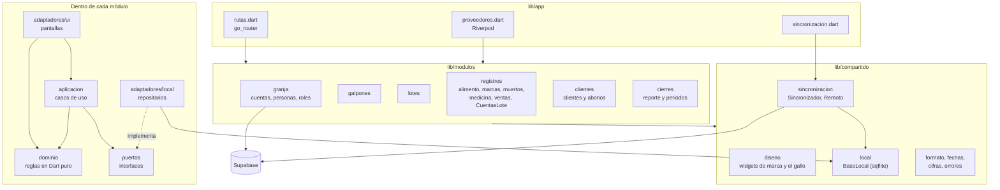
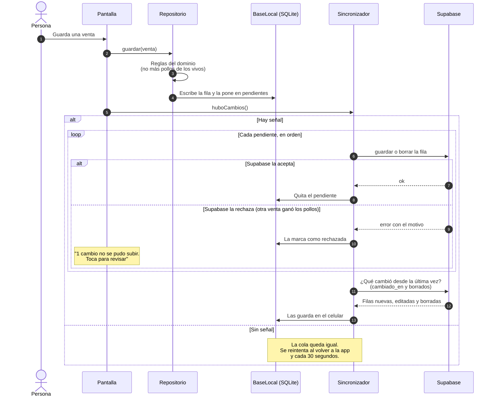
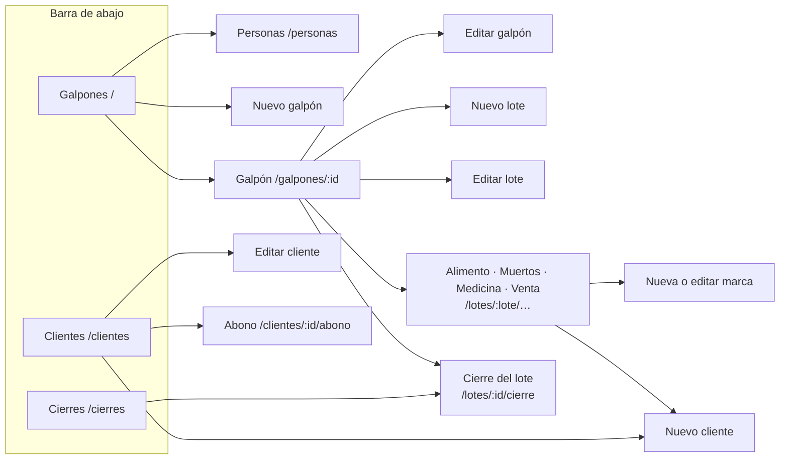
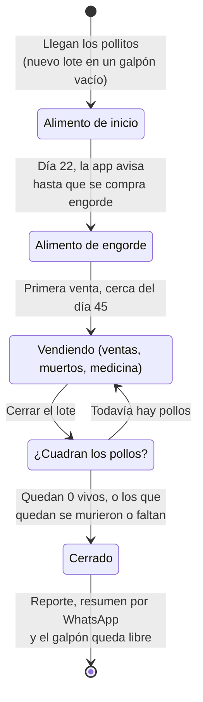
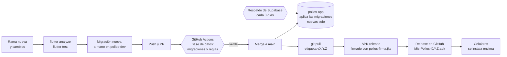

# Diagramas

GitHub dibuja estos diagramas solos (Mermaid). Son texto: cuando cambie el
código, se corrigen aquí en la misma rama.

1. [Módulos y capas](#1-módulos-y-capas)
2. [Cómo trabaja sin señal](#2-cómo-trabaja-sin-señal)
3. [Modelo de datos](#3-modelo-de-datos)
4. [A qué pantalla entra cada persona](#4-a-qué-pantalla-entra-cada-persona)
5. [Pantallas](#5-pantallas)
6. [Vida de un lote](#6-vida-de-un-lote)
7. [De un cambio al celular](#7-de-un-cambio-al-celular)

## 1. Módulos y capas

Cada módulo de negocio tiene su dominio en Dart puro y sus adaptadores. Las
pantallas nunca hablan con Supabase directo, salvo el módulo `granja`, que
necesita internet de todos modos. Detalle en [arquitectura.md](arquitectura.md).

## 2. Cómo trabaja sin señal

Todo se guarda primero en el celular. El sincronizador sube la cola en orden y
después baja lo que cambiaron los demás.

## 3. Modelo de datos

Todas las tablas del negocio llevan `granja_id`, y las reglas por fila (RLS)
solo muestran las de las granjas de la persona. Además tienen `creado_por`,
`creado_en`, `actualizado_por`, `actualizado_en` y `cambiado_en`, que no se
repiten en el diagrama.

La tabla `borrados` (tabla, fila_id, granja_id, borrado_en) anota cada fila que
se borra, para que los celulares que estaban sin señal también la quiten. Las
vistas `resumen_lotes` y `saldo_clientes` calculan los totales en el servidor.

## 4. A qué pantalla entra cada persona

`_destino` en `lib/app/rutas.dart` decide la pantalla cada vez que cambia la
sesión, el nombre o las granjas.

## 5. Pantallas

Las tres secciones de la barra de abajo y a dónde se llega desde cada una.

## 6. Vida de un lote

## 7. De un cambio al celular

Pasos completos en [publicar-una-version.md](publicar-una-version.md).

